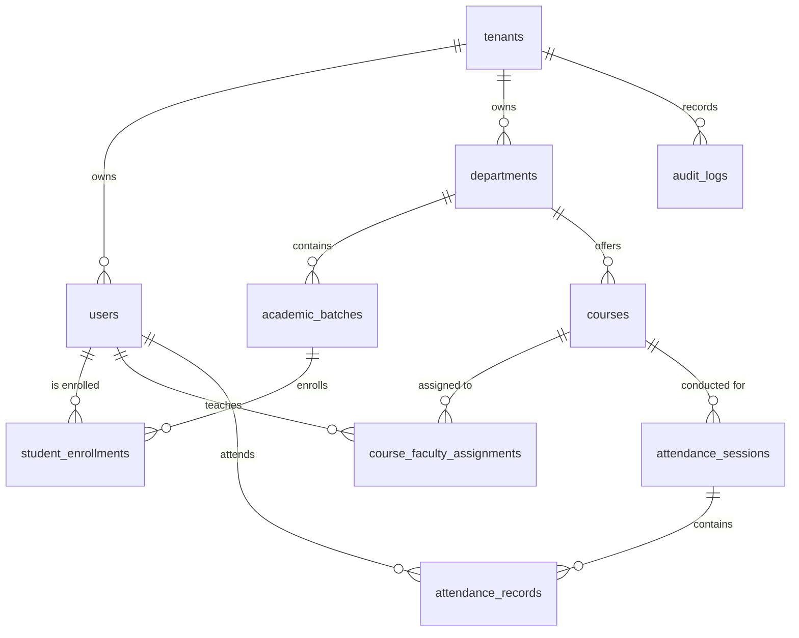

# Attendora — Long-Term System Memory & Knowledge Base

This document serves as the persistent memory, architectural blueprint, and domain knowledge repository for **Attendora**. It is designed to be ingested by AI coding assistants, system architects, and onboarding engineers.

---

## 1. Project Overview

### 1.1 Identity & Mission
- **System Name:** Attendora (Cloud-Based Academic Attendance & Compliance System)
- **Document Baseline ID:** ATD-PRD V1.0 (Production Master)
- **Domain:** Higher Education EdTech, Statutory Academic Governance, SaaS Multi-Tenancy
- **Mission:** Eradicate paper roll-call registers, proxy attendance, and spreadsheet corruption by providing a frictionless, multi-tenant digital attendance system that enables faculty to take attendance in seconds, gives students transparent compliance recovery calculations, and delivers audit-ready statutory reports to college administrators.

### 1.2 Target User Personas
1. **College Administrator / Academic Dean (e.g., Dr. Anita Roy):**
   - Monitors institutional compliance across all academic departments.
   - Generates official semester defaulter lists for statutory clearance.
   - Inspects immutable audit trails to resolve student attendance disputes.
2. **Faculty Member / Professor (e.g., Prof. Rajesh Deshmukh):**
   - Conducts 60-second digital roll-calls during lecture start.
   - Rapidly marks absent students with one-click bulk-mark defaults.
   - Reviews subject-level attendance trends and student health.
3. **Student (e.g., Sneha Kulkarni - Roll #20000001):**
   - Monitors personal attendance percentages across all enrolled subjects.
   - Uses the Shortage Recovery Calculator to understand how many consecutive classes are needed to restore good standing.
   - Uses the Affordable Absences buffer calculator to plan unavoidable medical absences.

---

## 2. Tech Stack

### 2.1 Web & Presentation Tier (Active Codebase)
| Layer | Technology | Version | Purpose |
| :--- | :--- | :--- | :--- |
| **Framework** | React | `^19.0.1` | Declarative UI component tree |
| **Language** | TypeScript | `^7.0.2` (Target ESNext) | Strict end-to-end type safety |
| **Styling** | Tailwind CSS | `^4.3.3` | Academic Governance Design System |
| **Bundler / Dev** | Vite | `^8.3.0` | Ultra-fast HMR and build pipeline |
| **Motion** | Motion (Framer) | `^12.23.24` | Gestures, swipe physics, modal transitions |
| **Icons** | Lucide React | `^0.546.0` | Clean enterprise icon system |
| **AI Integration** | `@google/genai` | `^2.4.0` | Gemini 2.5 server-side compliance insights |
| **Server Runtime** | Node.js | `v24.15.0` | Local build, testing, and dev host |

### 2.2 Target Backend & Persistence Tier (PRD Specification)
| Layer | Technology | Specification | Purpose |
| :--- | :--- | :--- | :--- |
| **Backend Framework** | Python Flask | `3.0+` / Gunicorn | Modular Monolith REST API |
| **Primary Database** | PostgreSQL | `16+` | Relational ACID storage with Row-Level Security (RLS) |
| **Partitioning** | PostgreSQL Partitioning | Range (`session_date`) | Sub-second queries on high-volume attendance records |
| **In-Memory Bus** | Redis | `7.2+` | Rate limiting, token deny-list, task queuing |
| **Task Worker** | RQ / Celery | Latest | Background CSV parsing, PDF generation, emails |
| **Password Hashing** | Argon2id | Industry Standard | High-entropy credential protection |
| **Auth Tokens** | JWT | Short-lived (15 min) | Scoped tenant and role access claims |

---

## 3. Features Completed

### 3.1 Presentation & Presentation Shell
- [x] **Universal Dual-Persona Switcher (`App.tsx`):** Seamless switcher to inspect Desktop Governance Dashboard, Mobile Student PWA, or Side-by-Side Showcase.
- [x] **Institutional Sidebar Navigation (`Sidebar.tsx`):** Navigation tabs (Dashboard, Roster, Defaulters, CSV Ingestion, Audit Logs, Settings) with college branding and user role badges.
- [x] **Showcase Presentation Harness (`ShowcaseView.tsx`):** Interactive presentation screen for institutional board reviews.

### 3.2 Desktop Governance & Administrative System
- [x] **Executive Metrics Strip (`DashboardMetrics.tsx`):** Instant KPI cards displaying Total Enrolled, Active Faculty, Campus-Wide Attendance Rate, and Critical Defaulter Headcount.
- [x] **Daily Attendance Trend Chart (`AttendanceTrendChart.tsx`):** Interactive SVG visualizer displaying scheduled vs attended student trends across week days.
- [x] **Student Roster Management (`StudentRosterTable.tsx`):** High-density student table with real-time text search, department filtering, status filters (Present / Low Rate), and individual record modification overrides.
- [x] **Digital Roll-Call Modal (`RollCallModal.tsx`):**
  - Real-time digital roll-call interface.
  - "Mark All Present" one-click action.
  - Quick student status toggle (Present / Absent) with count badges.
  - Automatic session finalization and locking.
- [x] **Statutory Defaulters Report Modal (`DefaultersReportModal.tsx`):**
  - Dynamic threshold filtering (e.g., students below 75% or 70%).
  - Detailed breakdown of classes conducted, attended, and shortfall count.
  - One-click CSV export and browser PDF print preview trigger.
- [x] **Batch CSV Ingestion Modal (`CsvImportModal.tsx`):**
  - RFC-4180 CSV roster file upload with header inspection.
  - Row-by-row syntax validation (email regex, duplicate roll detection).
  - Validation error drawer highlighting exact offending row numbers.
  - Batch onboarding state update with audit logging.
- [x] **Tamper-Resistant Audit Trail Modal (`AuditLogModal.tsx`):**
  - Complete chronological log of all roll-call submissions, bulk imports, and manual rate overrides.
  - Detail inspection drawer revealing Actor, Role, Previous Status, New Status, and written justification reason.

### 3.3 Student Mobile Experience (PWA)
- [x] **Mobile Dashboard Shell (`MobileStudentApp.tsx`):** High-contrast, mobile-first design with bottom navigation (Dashboard, Schedule, Recovery, Profile).
- [x] **Course Compliance Gauges:** Circular SVG progress meters showing individual course attendance rates color-coded by compliance tier (Safe, Low, Critical).
- [x] **Predictive Shortage Recovery Calculator:** Computes exact consecutive upcoming classes a student must attend to recover back to $75.0\%$.
- [x] **Affordable Absences Planner:** Computes how many safe cuts a student can afford before falling below $75.0\%$.
- [x] **Lecture Timetable Timeline:** Chronological listing of daily lecture slots, room locations, and faculty names.
- [x] **Notification Drawer:** Real-time push alert simulation for attendance drops and institutional circulars.

### 3.4 Domain Utilities & Unit Tests
- [x] `calculateAttendancePercentage()`: Pure percentage math with zero-conducted safety (`src/utils/attendance.ts`).
- [x] `getComplianceStatus()`: Categorization into `COMPLIANT`, `WARNING`, and `CRITICAL`.
- [x] `calculateRecoveryClasses()`: Deterministic shortage recovery math.
- [x] `calculateAffordableAbsences()`: Safe absence cushion math.
- [x] `validateCsvRoster()`: Pre-validation of roster headers and row formats.
- [x] `generateAttendanceReportDeepLink()`: Verification of deep link URL creation.
- [x] Full unit test coverage in `src/utils/attendance.test.ts`.

### 3.5 Phase 2 & Phase 3 Advanced Systems
- [x] **PostgreSQL 16+ Multi-Tenant Schema & RLS Migrations:** `migrations/001` through `004` enforcing kernel isolation via `app.current_tenant_id` and monthly range partitioning on `attendance_records(session_date)`.
- [x] **Modular Monolith REST Backend API:** Python Flask domain blueprints (`backend/`) and Express TypeScript companion server (`src/server/index.ts`).
- [x] **Dynamic Rolling QR Code Engine:** 10-second TOTP token generator with Haversine GPS geo-fencing (`qrAttendance.ts`).
- [x] **Faculty Projector View Modal (`DynamicQrDisplayModal.tsx`):** Real-time rotating QR code with live countdown ring and student check-in counters.
- [x] **Student Mobile QR Scanner (`StudentQrScannerModal.tsx`):** Viewfinder with geolocation verification and distance feedback.
- [x] **Multi-Channel Alert Dispatcher (`NotificationDispatchModal.tsx` & `notifications.ts`):** Automated statutory notice generation for SMS (Twilio), WhatsApp, and Email.
- [x] **Campus Turnstile & Biometric Ingestion (`HardwareIntegrationModal.tsx` & `hardwareIntegration.ts`):** Punch reconciliation engine mapping RFID gate entries to academic lecture slots.
- [x] **Offline PWA & Sync Engine (`offlineStorage.ts` & `public/sw.js`):** IndexedDB roll-call queue allowing offline classroom attendance with automatic reconnection flush.

### 3.6 Phase 4 AI, Enterprise SIS & Accreditation Systems
- [x] **Gemini 2.5 AI Early Dropout & Failure Predictor (`aiRetention.ts` & `AiRetentionModal.tsx`):** Machine learning retention model detecting high-deficit attendance trajectories weeks before exams.
- [x] **Enterprise SIS / LMS Standard Integration (`lmsIntegration.ts`):** LTI 1.3 standard compliance for Canvas, Moodle, and Blackboard embedding; automated enrollment sync via Ellucian Banner / SAP.
- [x] **Automated Examination Hall-Ticket Withholding Engine (`hallTicketGating.ts` & `HallTicketGatingModal.tsx`):** Algorithmic gating barring unapproved $< 75\%$ defaulters with digital administrative waiver workflows and invigilator QR stamps.
- [x] **Accreditation Audit Export Engine (`accreditationExport.ts` & `AccreditationExportModal.tsx`):** One-click generation of National Board of Accreditation (NBA Criterion 2) and NAAC statutory attendance records with cryptographic institutional seal.

---

## 4. Completed Baseline & Ongoing Enterprise Enhancements

All four primary roadmap phases (Phase 1 through Phase 4) are fully implemented and verified. Future enhancement targets:
- Direct hardware firmware drivers for dedicated biometric optical turnstile manufacturers.
- Multi-campus distributed database clustering across geographic regions.
- Advanced multi-tenant billing with automated Razorpay/Stripe usage meters.

---

## 5. API Endpoints Specification

### 5.1 Platform Superadmin Routes
```http
POST   /api/v1/platform/tenants          # Provision a new college tenant
GET    /api/v1/platform/tenants          # List all registered institutions
GET    /api/v1/platform/tenants/:id      # Tenant operational statistics
PATCH  /api/v1/platform/tenants/:id      # Update tenant subscription status
```

### 5.2 Authentication & Profile Routes
```http
POST   /api/v1/auth/login                # Authenticate credentials, return JWT & set cookie
POST   /api/v1/auth/refresh              # Rotate refresh token and issue new 15m access token
POST   /api/v1/auth/logout               # Revoke active token in Redis deny-list
GET    /api/v1/auth/me                   # Return profile of authenticated user
```

### 5.3 Academic Engine & Roster Routes
```http
GET    /api/v1/departments               # List college departments
GET    /api/v1/batches                   # List academic batches and divisions
GET    /api/v1/courses                   # List active courses and faculty assignments
GET    /api/v1/students                  # Query enrolled students (with search & filters)
POST   /api/v1/students/bulk             # Multipart CSV upload for batch onboarding
```

### 5.4 Attendance Session & Roll-Call Routes
```http
POST   /api/v1/attendance/sessions       # Submit finalized lecture roll-call
GET    /api/v1/attendance/sessions       # Query historical sessions by date/course
GET    /api/v1/attendance/sessions/:id   # Get detailed record marks for a session
PATCH  /api/v1/attendance/sessions/:id   # Administrative override (requires written reason)
```

### 5.5 Compliance, Reports & Audit
```http
GET    /api/v1/reports/defaulters        # Query students below compliance threshold
POST   /api/v1/reports/export-csv        # Trigger async CSV export download
POST   /api/v1/reports/export-pdf        # Trigger async PDF statutory report generation
GET    /api/v1/audit/logs                # Retrieve tamper-resistant institutional audit trail
```

---

## 6. Database Schema Summary



### 6.1 Platform Metadata Tables (No RLS)
- `tenants`: `id` (UUID PK), `name`, `slug` (UNIQUE), `custom_domain`, `subscription_plan`, `student_quota_limit`, `created_at`.
- `platform_superadmins`: `id` (UUID PK), `email`, `password_hash` (Argon2id), `is_active`.
- `tenant_subscriptions`: `id` (UUID PK), `tenant_id` (FK), `external_customer_id`, `current_period_end`, `auto_renew`.

### 6.2 Tenant-Scoped Tables (RLS Enforced by `tenant_id`)
- `users`: `id` (UUID PK), `tenant_id` (FK), `email`, `password_hash`, `role` (`COLLEGE_ADMIN`, `FACULTY`, `STUDENT`), `full_name`, `is_active`.
- `departments`: `id` (UUID PK), `tenant_id` (FK), `code`, `name`.
- `academic_batches`: `id` (UUID PK), `tenant_id` (FK), `department_id` (FK), `academic_year`, `semester`, `division`.
- `courses`: `id` (UUID PK), `tenant_id` (FK), `department_id` (FK), `course_code`, `course_name`, `default_minimum_attendance_pct` (75.00).
- `course_faculty_assignments`: `id` (UUID PK), `tenant_id` (FK), `course_id` (FK), `faculty_id` (FK), `batch_id` (FK).
- `student_enrollments`: `id` (UUID PK), `tenant_id` (FK), `student_id` (FK), `batch_id` (FK), `roll_number`, `prn_number`.
- `attendance_sessions`: `id` (UUID PK), `tenant_id` (FK), `course_id` (FK), `batch_id` (FK), `faculty_id` (FK), `session_date` (DATE), `slot_start_time`, `slot_end_time`, `is_locked` (BOOLEAN DEFAULT TRUE), `created_at`.
- `attendance_records` *(Partitioned by `session_date`)*: `id` (BIGSERIAL), `tenant_id` (FK), `session_id` (FK), `student_id` (FK), `status` (`PRESENT`, `ABSENT`, `EXCUSED`), `marked_at`.
- `audit_logs` *(Immutable Append-Only)*: `id` (BIGSERIAL PK), `tenant_id` (FK), `actor_id` (FK), `action`, `entity_type`, `entity_id`, `ip_address`, `user_agent`, `old_state` (JSONB), `new_state` (JSONB), `reason` (TEXT), `created_at`.

---

## 7. Important Business Logic & Rules

### 7.1 Attendance Calculation & Safety
- **Formula:** `(attended / conducted) * 100` rounded to 1 decimal place.
- **Div/0 Invariant:** When `conducted == 0`, attendance rate must evaluate to `100.0%` (new semester baseline).
- **Upper Bound Invariant:** `attended` can never exceed `conducted`.

### 7.2 Statutory Compliance Tiers
- **COMPLIANT:** $\ge 75.0\%$
- **WARNING:** $70.0\% - 74.9\%$
- **CRITICAL:** $< 70.0\%$

### 7.3 Recovery Classes Formula
$$\text{Classes Needed} = \max\left(0, \left\lceil \frac{0.75 \times \text{conducted} - \text{attended}}{0.25} \right\rceil\right)$$

### 7.4 Affordable Absence Buffer Formula
$$\text{Safe Cuts} = \max\left(0, \left\lfloor \frac{\text{attended} - 0.75 \times \text{conducted}}{0.75} \right\rfloor\right)$$

### 7.5 Session Lock & Audit Policy
1. Normal roll-call entry locks the session record immediately upon submission.
2. An override can only be initiated by a user with role `COLLEGE_ADMIN` or designated Department Head.
3. Overriding requires providing a mandatory justification reason; this creates an unalterable log in `audit_logs`.

---

## 8. Known Issues & Technical Debt

1. **Client-Side State Persistence:** Currently, mutations (new roll-calls, student edits, CSV imports) reside in React state in `App.tsx` and reset upon hard browser reload. *Resolution: Connect to live backend API.*
2. **CSV Import Streaming:** The in-browser parser loads the full array of rows into memory. Files exceeding 10,000 rows should be delegated to chunked streaming via backend worker.
3. **Tailwind v4 Configuration:** Uses Vite plugin `@tailwindcss/vite` rather than legacy `tailwind.config.js`. Future plugins should be registered via CSS directives.

---

## 9. Future Roadmap

> [!NOTE]
> See [phases.md](file:///d:/Cloud%20Computing/Attendora/phases.md) for the complete, granular Work Breakdown Structure (WBS), risk mitigations, and Definition of Done across all phases.

| Milestone | Target Horizon | Core Deliverables |
| :--- | :--- | :--- |
| **Phase 1: Baseline MVP UI & UX** | **Completed (Nov 2026)** | Dual-Persona Presentation, Desktop Dashboard, Roll-Call Modal, Defaulters Report, CSV Ingestion, Student Mobile PWA, Audit Logger. |
| **Phase 2: Production Backend & PostgreSQL RLS** | **Q4 2026** | Python Flask Modular Monolith, PostgreSQL RLS schema migrations, JWT auth with httpOnly cookies, Redis task broker. |
| **Phase 3: Hardware Integrations & Notifications** | **Q1 2027** | Rotating dynamic QR code attendance, Twilio SMS/WhatsApp integration, campus RFID webhook ingestors. |
| **Phase 4: Predictive Analytics & SIS Integration** | **Q2 2027** | Gemini-powered early dropout prediction, Canvas/Moodle LTI plugins, automated semester hall-ticket issuance gating. |

