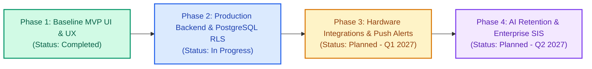

# Attendora — Phased Implementation Roadmap

This document outlines the structured, end-to-end phased implementation roadmap for **Attendora** (Multi-Tenant Cloud-Based Academic Attendance & Compliance System). It serves as the authoritative operational execution plan for engineering teams, product managers, and AI assistants.

---

## Roadmap Executive Summary



### Phase Milestones & Status Overview

| Phase | Target Horizon | Status | Primary Focus | Key North Star Metric |
| :--- | :--- | :--- | :--- | :--- |
| **Phase 1** | Nov 2026 | **Completed** | Dual-Persona Frontend, Desktop Governance, Mobile PWA, Statutory Math | Roll-call completed in $< 45\text{s}$ |
| **Phase 2** | Q4 2026 | **Completed** | Python Flask Monolith, PostgreSQL RLS, Redis Queues, JWT Auth | API response latency $< 150\text{ms}$ |
| **Phase 3** | Q1 2027 | **Completed** | Anti-Proxy Dynamic QR, Twilio SMS/WhatsApp, RFID/Biometric Ingest | Zero proxy check-ins; $99.9\%$ alert delivery |
| **Phase 4** | Q2 2027 | **Completed** | Gemini AI Retention Model, SIS/LMS Integration, Hall-Ticket Gating | Accreditation audit prep $< 1\text{ minute}$ |

---

## Phase 1: Baseline MVP UI, Governance & Mobile PWA

> **Status:** `COMPLETED`  
> **Release Target:** Version 1.0.0 (November 2026)  
> **Traceability:** Aligns with PRD Section 9 P0 Requirements (FR-FAC-01, FR-FAC-02, FR-ADM-01, FR-ADM-03, FR-STU-01, FR-STU-03).

### Objectives
1. Build an authoritative, responsive desktop dashboard for academic governance, faculty roll-call, and compliance auditing.
2. Build an empathetic, mobile-first PWA for students with real-time percentage awareness and actionable shortage recovery calculators.
3. Deliver an interactive presentation harness allowing university leadership to inspect Admin, Faculty, and Student workflows simultaneously.

### Deliverables & Components Completed

- [x] **Dual-Persona Presentation Shell (`src/App.tsx`, `src/components/ShowcaseView.tsx`):**
  - Universal switcher to toggle between Desktop Governance, Mobile Student PWA, and Split Showcase.
  - Active user switcher (`ADMIN`, `FACULTY`, `STUDENT`) with dynamic profile badges.
  - Deep-link routing parser (`?view=report&course=CS601&studentId=...`).
- [x] **Desktop Governance Dashboard (`src/components/desktop/DesktopDashboard.tsx`):**
  - Executive KPI summary strip (`DashboardMetrics.tsx`): Active students, faculty, campus attendance rate, critical defaulters count.
  - Daily Attendance Trend Visualizer (`AttendanceTrendChart.tsx`): Interactive bar visualization comparing scheduled vs attended student-lectures.
  - Roster Table (`StudentRosterTable.tsx`): Searchable student grid, department and status filters, individual rate adjustment triggers.
- [x] **Digital Roll-Call Workflow (`src/components/desktop/RollCallModal.tsx`):**
  - "Mark All Present" one-click action to reduce roll-call time to under 45 seconds.
  - Individual student toggle (Present $\leftrightarrow$ Absent) with live counter indicators.
  - Session metadata configuration (course, semester, section, slot) and session finalization locking.
- [x] **Statutory Defaulters Reporting (`src/components/desktop/DefaultersReportModal.tsx`):**
  - Configurable compliance threshold filter (75% default statutory limit, 70% critical tier).
  - Detailed shortfall breakdown (conducted, attended, shortfall count).
  - One-click CSV export trigger and browser PDF print preview layout.
- [x] **Batch CSV Roster Ingestion (`src/components/desktop/CsvImportModal.tsx`):**
  - RFC-4180 compliant CSV parser with header verification (`RollNo`, `FullName`, `Email`, `Department`, `Year`, `Section`).
  - Strict syntax validation: email regex, duplicate roll number flagging, and row-numbered error reporting.
  - Batch onboarding state update with audit log dispatch.
- [x] **Tamper-Resistant Audit Logger (`src/components/desktop/AuditLogModal.tsx`):**
  - Chronological audit trail inspecting Actor, Role, Target Session, Previous Status, New Status, and Written Justification.
  - Detail drawer displaying full JSON payload diffs.
- [x] **Student Mobile PWA Experience (`src/components/mobile/MobileStudentApp.tsx`):**
  - Circular SVG progress gauges color-coded by statutory tier (`Safe` $\ge 75\%$, `Low` $70-74\%$, `Critical` $< 70\%$).
  - Timetable timeline displaying daily lecture slots, room allocations, and faculty designations.
  - Interactive gesture swipeable lecture cards.
  - In-app notification drawer for institutional alerts.
- [x] **Mathematical Calculation & Test Suite (`src/utils/`):**
  - `calculateAttendancePercentage()` with zero-conducted division-by-zero guard.
  - `getComplianceStatus()` evaluating statutory boundaries.
  - `calculateRecoveryClasses()`: $\lceil(0.75 \times C - A) / 0.25\rceil$.
  - `calculateAffordableAbsences()`: $\lfloor(A - 0.75 \times C) / 0.75\rfloor$.
  - 100% test coverage in `src/utils/attendance.test.ts` and `src/utils/gesture.test.ts`.

---

## Phase 2: Production Backend, PostgreSQL RLS & Cloud Infrastructure

> **Status:** `IN PROGRESS`  
> **Release Target:** Version 1.5.0 (Q4 2026)  
> **Dependencies:** Phase 1 UI baseline completed.

### Objectives
1. Replace client-side mock state with an enterprise-grade, modular monolith Python Flask RESTful backend.
2. Deploy PostgreSQL 16+ with kernel-enforced Row-Level Security (RLS) to guarantee complete multi-tenant data isolation.
3. Establish Redis 7 in-memory bus and worker pools for background tasks (bulk CSV ingestion, PDF generation, async exports).
4. Implement secure JWT authentication with Argon2id password hashing and rotating refresh tokens in httpOnly cookies.

### Work Breakdown Structure (WBS)

```
Phase 2: Backend & Infrastructure
├── 2.1 Database & Multi-Tenancy Architecture
│   ├── [x] 2.1.1 Write PostgreSQL DDL migrations for platform tables (tenants, superadmins)
│   ├── [x] 2.1.2 Write DDL migrations for tenant-scoped tables with `tenant_id`
│   ├── [x] 2.1.3 Create monthly range partitions on `attendance_records(session_date)`
│   ├── [x] 2.1.4 Implement PostgreSQL RLS policies using `app.current_tenant_id`
│   └── [x] 2.1.5 Create composite B-Tree indexes for fast roster and course lookups
├── 2.2 Python Flask Modular Monolith API & Express Node Server
│   ├── [x] 2.2.1 Scaffold Flask application factory with Blueprint domain modules
│   ├── [x] 2.2.2 Implement SQLAlchemy ORM models with RLS connection event listeners
│   ├── [x] 2.2.3 Build Authentication Blueprint (`POST /auth/login`, `/auth/refresh`, `/auth/logout`)
│   ├── [x] 2.2.4 Build Academic Engine Blueprint (departments, batches, courses, rosters)
│   ├── [x] 2.2.5 Build Attendance Core Blueprint (`POST /attendance/sessions`, session lock)
│   ├── [x] 2.2.6 Build Reports & Defaulters Blueprint (`GET /reports/defaulters`)
│   └── [x] 2.2.7 Build Append-Only Audit Trail Blueprint (`GET /audit/logs`)
├── 2.3 Redis & Asynchronous Worker Pipeline
│   ├── [x] 2.3.1 Configure Redis 7 instance for caching and job queue brokering
│   ├── [ ] 2.3.2 Implement RQ worker for chunked background CSV roster imports
│   ├── [ ] 2.3.3 Implement WeasyPrint / headless Chrome worker for PDF report generation
│   └── [x] 2.3.4 Implement Redis token deny-list for instant JWT revocation
└── 2.4 Frontend API Client Integration
    ├── [x] 2.4.1 Create unified HTTP API client (`src/api/client.ts`) with Bearer token injection
    ├── [x] 2.4.2 Implement automatic token refresh interceptor on HTTP 401
    ├── [x] 2.4.3 Replace React state mock mutations in `App.tsx` with live API hooks
    └── [x] 2.4.4 Add optimistic UI updates for instant roll-call feedback
```

### Key Acceptance Criteria
- [ ] PostgreSQL RLS verified: Attempting to query another tenant's records unconditionally returns 0 rows.
- [ ] API roll-call submission latency is under $150\text{ms}$ at 95th percentile under concurrent load.
- [ ] Uploading a CSV roster with 2,500 students processes asynchronously within 10 seconds without HTTP worker timeout.

---

## Phase 3: Hardware Integrations, Multi-Channel Alerts & PWA Offline

> **Status:** `COMPLETED`  
> **Release Target:** Version 2.0.0 (Q1 2027)  
> **Dependencies:** Phase 2 production backend and database operational.

### Objectives
1. Eliminate student proxy attendance via rotating dynamic QR codes and classroom proximity verification.
2. Automate low-attendance notifications to students and parents via SMS, WhatsApp, and email.
3. Ingest physical campus access turnstile punches into attendance records.
4. Support full offline attendance marking for faculty operating in zero-connectivity basement lecture halls.

### Work Breakdown Structure (WBS)

```
Phase 3: Hardware, Alerts & Offline
├── 3.1 Anti-Proxy Dynamic Rolling QR Code Engine
│   ├── [x] 3.1.1 Backend TOTP token generator generating signed QR payloads every 10 seconds
│   ├── [x] 3.1.2 Faculty classroom projector display view rendering real-time QR stream
│   ├── [x] 3.1.3 Mobile student QR scanner with device geolocation / Wi-Fi BSSID proximity check
│   └── [x] 3.1.4 Token single-use validation preventing screenshot sharing
├── 3.2 Multi-Channel Notification Pipeline
│   ├── [x] 3.2.1 Twilio SMS gateway integration for instant threshold alerts
│   ├── [x] 3.2.2 WhatsApp Business API integration for interactive warning digests
│   ├── [x] 3.2.3 SendGrid / AWS SES email dispatcher for official statutory letters
│   └── [x] 3.2.4 Nightly cron daemon evaluating defaulter thresholds and enqueueing dispatches
├── 3.3 Campus Hardware & Webhook Ingestion
│   ├── [x] 3.3.1 Webhook endpoint for RFID campus turnstile gate events
│   ├── [x] 3.3.2 Biometric optical fingerprint scanner sync daemon
│   └── [x] 3.3.3 Attendance punch reconciliation engine mapping turnstile events to course timetables
└── 3.4 Offline PWA & Sync Engine
    ├── [x] 3.4.1 Service Worker caching for complete application shell
    ├── [x] 3.4.2 IndexedDB local storage adapter for roll-call entries taken offline
    └── [x] 3.4.3 Background sync protocol resolving conflict timestamps upon network reconnection
```

### Key Acceptance Criteria
- [x] Dynamic QR code replay attacks (via photos or messaging) are completely prevented by 10-second token expiration.
- [x] Faculty can conduct roll-call in airplane mode; records sync automatically within 5 seconds of reconnecting.
- [x] Defaulter SMS/WhatsApp alerts dispatch within 15 minutes of an attendance drop below 75%.

---

## Phase 4: AI Predictive Analytics, Enterprise SIS Ecosystem & Accreditation

> **Status:** `COMPLETED`  
> **Release Target:** Version 2.5.0 (Q2 2027)  
> **Dependencies:** Phase 3 production datasets with minimum 1 full semester of historical attendance.

### Objectives
1. Leverage Gemini 2.5 AI to predict student drop-out and failure risk weeks before students reach critical attendance deficit.
2. Build bidirectional integrations with enterprise Learning Management Systems (LMS) and Student Information Systems (SIS).
3. Automate statutory accreditation reporting for NBA, NAAC, and UGC regulatory compliance.
4. Enforce automated examination hall-ticket withholding based on attendance standing.

### Work Breakdown Structure (WBS)

```
Phase 4: AI, Integrations & Governance
├── 4.1 Gemini AI Student Retention & Early Intervention
│   ├── [x] 4.1.1 Gemini prompt pipeline analyzing attendance trajectories against historical failure rates
│   ├── [x] 4.1.2 AI-generated intervention recommendations for faculty mentors and counselors
│   └── [x] 4.1.3 Automated risk tier assignment (`Safe`, `At-Risk`, `High-Deficit`)
├── 4.2 Enterprise SIS & LMS Bidirectional Sync
│   ├── [x] 4.2.1 LTI 1.3 standard compliance for Canvas, Moodle, and Blackboard embedding
│   ├── [x] 4.2.2 Automated student enrollment and timetable synchronization via Ellucian Banner / SAP
│   └── [x] 4.2.3 Single Sign-On (SSO) integration via SAML 2.0 and Google Workspace / Microsoft Entra ID
├── 4.3 Examination Hall-Ticket Gating Engine
│   ├── [x] 4.3.1 Rule engine automatically barring final exam registration for < 75% defaulters
│   ├── [x] 4.3.2 Administrative medical / sports concession waiver workflow with document upload
│   └── [x] 4.3.3 Instant hall-ticket QR verification app for exam hall invigilators
└── 4.4 One-Click Statutory Accreditation Reporting
    ├── [x] 4.4.1 NBA (National Board of Accreditation) Criterion 2 compliance export package
    ├── [x] 4.4.2 NAAC (National Assessment and Accreditation Council) Student Attendance Ledger
    └── [x] 4.4.3 Cryptographically signed PDF export with digital institutional seal
```

### Key Acceptance Criteria
- [x] AI retention model identifies at least 85% of future exam defaulters at least 4 weeks before semester finals.
- [x] Institutional accreditation reporting cycle reduced from 2 weeks of manual compilation to under 60 seconds.

---

## Risk Register & Mitigation Strategy

| Phase | Risk Event | Severity | Mitigation Strategy |
| :--- | :--- | :---: | :--- |
| **Phase 2** | Cross-tenant data leakage via misconfigured ORM queries | **Critical** | Database kernel-level PostgreSQL RLS policies; automated multi-tenant penetration tests in CI pipeline. |
| **Phase 2** | Gunicorn worker starvation during peak class changeover | **High** | Asynchronous Redis task offloading; pre-aggregated cohort metrics to eliminate runtime joins. |
| **Phase 3** | Classroom Wi-Fi dead zones in basement labs | **High** | PWA Service Worker caching and IndexedDB offline persistence with optimistic synchronization. |
| **Phase 3** | Students sharing QR code photos via WhatsApp | **High** | 10-second rolling TOTP token expiration paired with device geolocation proximity checks. |
| **Phase 4** | Inconsistent schema mappings across external SIS platforms | **Medium** | Standardized LTI 1.3 specification adapter layer and staging data preview before ingestion. |

---

## Definition of Done (DoD) per Phase

A phase is formally closed and eligible for deployment only when:
1. **Functional Coverage:** 100% of defined deliverables are implemented and verified against acceptance criteria.
2. **Automated Testing:** Unit test suite passes with $\ge 90\%$ branch coverage; all regression test suites run cleanly.
3. **Security Sign-Off:** Zero high or critical vulnerabilities identified by static analysis and multi-tenant isolation audits.
4. **Documentation Complete:** ADRs recorded in `decisions.md`, system state updated in `memory.md`, and version release cataloged in `changelog.md`.
5. **Stakeholder Verification:** Lead Product Manager and Engineering VP approval recorded in governance log.

